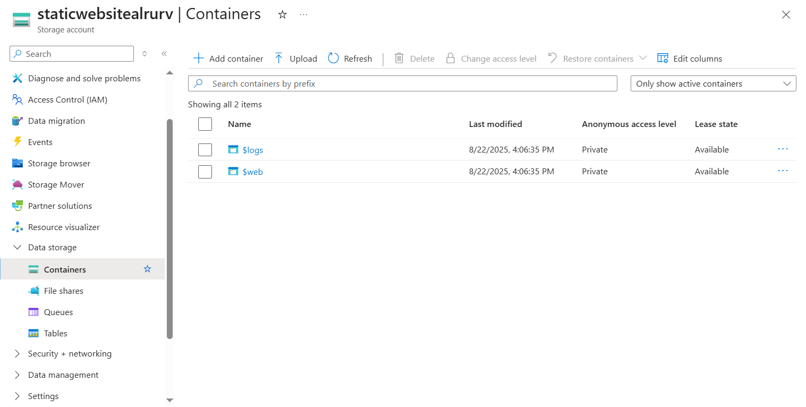
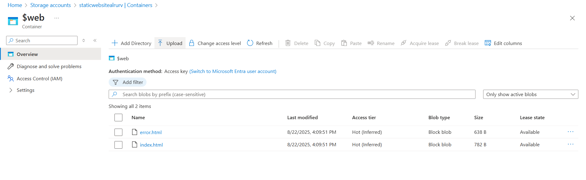
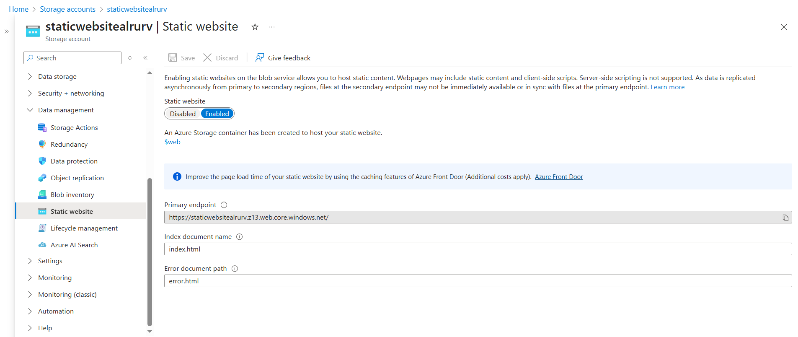

# Deploy Static Website Using Terraform

This section walks through how to deploy the static website using **Terraform commands**, upload content, verify the deployment, and destroy resources.


## Initialize and Apply Terraform

Run the following commands inside your project directory:

```bash
# Initialize Terraform (downloads providers and sets up backend)
terraform init

# Validate configuration (checks syntax and correctness)
terraform validate

# Terraform Format
terraform fmt

# Terraform Plan
terraform plan

# Apply changes (provisions Azure resources)
terraform apply -auto-approve
```


## Upload Static Content

After provisioning the infrastructure:

1. Open the **Azure Portal**.  

2. Navigate to the **Storage Account** created by Terraform.  


3. Under **Data storage → Containers**, open the `$web` container (auto-created by the `static_website` feature).  



4. Upload your static site files:  
   - `error.html`
   - `index.html` 




## Verify Deployment

1. To access the website, go to the **Storage Account**, navigate to the **Data Management** blade and click on **Static Website**. 



2. Copy the **Primary endpoint** URL.  

`https://staticwebsitealrurv.z13.web.core.windows.net/`

To confirm the error page:  
`https://staticwebsitealrurv.z13.web.core.windows.net/error`

3. Paste the endpoint into your browser, you should see **`index.html`** and **`error.html`** render.  


## Destroy and Clean-Up

When you are done, remove the resources and Terraform state:

```bash
# Destroy all resources created by Terraform
terraform destroy -auto-approve

# Delete Terraform state files (.terraform/ directory, .terraform.lock.hcl file, and terraform.tfstate* files)
rm -rf .terraform* terraform.tfstate* 
OR
rm -Recurse -Force .terraform*, terraform.tfstate*

```


